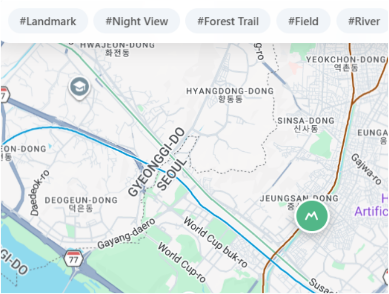
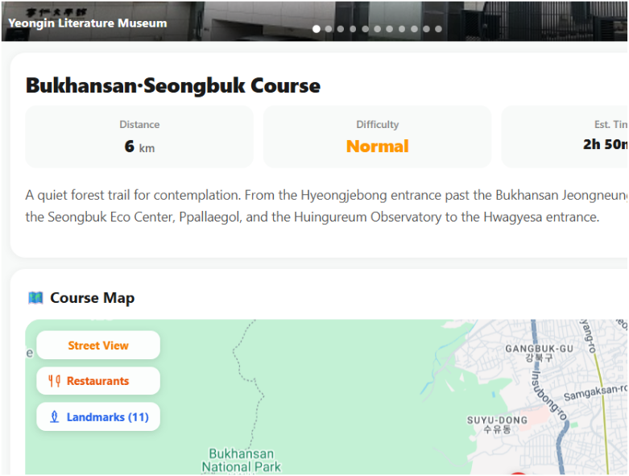
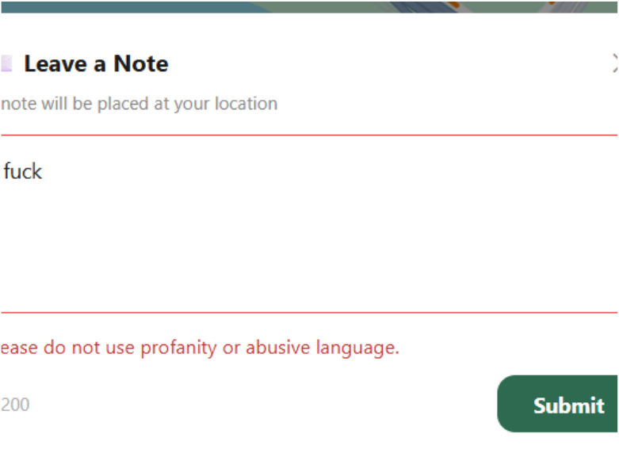

# GlobalStep — 외국인 맞춤형 다국어 산책로 통합 가이드

> 서울시 공공데이터(두드림길)를 GIS 경로로 재가공하고, 회원가입 없이 다국어로 탐색할 수 있게 만든 위치 기반 서비스의 **백엔드 설계·구현 기록**입니다.

<p>
  
  
  
  
  
</p>

| 항목 | 내용 |
| --- | --- |
| 프로젝트명 | GlobalStep |
| 팀명 | Full-Back (4인) |
| 기간 | 2026년 상반기 (개발 8주) · 최종보고서 v1.0 (2026-06-05) |
| 서비스 | https://global-step-silk.vercel.app/ |
| 구분 | 명지대학교 융합소프트웨어학부 설계/프로젝트 |
| 본 저장소 | 원본 코드는 비공개 저장소에 있으며, 이 저장소는 **설계 문서 · 발표자료 · 기술 의사결정 기록**을 정리한 쇼케이스입니다. |

---

## 1. 한 줄 요약

재한 외국인의 **43.4%가 언어 장벽으로 여가 생활에 불편**을 겪지만, 서울시 산책로 공공데이터는 한국어 텍스트/행정 데이터로만 제공됩니다.
GlobalStep은 이 데이터를 **TM(EPSG:5181) → WGS84 좌표 변환**으로 지도 위 GIS 경로로 재구성하고, **회원가입 없이(Zero-Barrier) 태그만으로(No-Search)** 다국어 탐색이 가능한 통합 가이드를 제공합니다.

## 2. 담당 역할 — 이성은

| 영역 | 담당 내용 |
| --- | --- |
| **백엔드 전반** | Spring Boot 3.x 기반 REST API 설계·구현. Course / Place / Note / Review / Guest / Map 6개 도메인, JPA 엔티티 및 다국어 컬럼 스키마 설계, MySQL Spatial 공간 쿼리, 전역 예외·응답 규격, Swagger 문서화 |
| **LLM 비속어 필터링** | Solar(Upstage) LLM 기반 다국어 모더레이션 파이프라인 설계·구현. 호출 예산/동시성 가드(`SolarCallGuard`) + Rule-Based 폴백(`RuleBasedProfanityFilter`)의 2단 방어 구조 |
| (참고) | 성능/부하 테스트(k6)는 팀원이 담당했으며, 본 문서에는 결과 지표만 인용합니다. |

## 3. 핵심 성과

| 지표 | 목표 | 결과 |
| --- | --- | --- |
| 다국어 정보 만족도 (UAT) | 5점 만점 중 4.0 이상 | **4.2점** ✅ |
| 부하 환경 가용성 | 99% 이상 | **100%** (2,166 요청 중 에러 0건) ✅ |
| 평균 응답 시간 | 1초 미만 | **16.9ms** (피크 시에도 218ms 이내) ✅ |
| GIS 경로 정합성 | 위치 오차 10m 이내 | **10m 이내 전수 확인** ✅ |
| 데이터 적재 | 코스·POI 각 100건 이상 | 서울 전역 GIS 트랙 100+ / 정제 POI 100+ ✅ |

## 4. 시스템 아키텍처


```
[Next.js / Vercel]  ──HTTPS──▶  [Nginx (Public Subnet)]
                                      │
                                      ▼
                          [Spring Boot on EC2 (Private Subnet)]
                                      │
                    ┌─────────────────┼─────────────────┐
                    ▼                 ▼                 ▼
        [MySQL Spatial / RDS]   [Amazon S3]     [Upstage Solar API]
         공간 인덱스·다국어      이미지 아카이빙    비속어 모더레이션
```

자세한 구성·ERD·배포 파이프라인은 **[docs/03-architecture.md](docs/03-architecture.md)** 참고.

## 5. 기술 스택

| 구분 | 사용 기술 |
| --- | --- |
| Language / Runtime | Java 25 (Toolchain) |
| Framework | Spring Boot 3.5.5, Spring Data JPA, Spring Validation |
| Database | MySQL 8.x + Spatial Extension, Hibernate Spatial 6.6, JTS 1.20 |
| API 문서 | springdoc-openapi 2.7 (Swagger UI) |
| 외부 연동 | Google Maps (Distance Matrix / Street View / 딥링크), Kakao Map 딥링크, Upstage Solar LLM |
| Infra | AWS EC2 · RDS · S3, Nginx, Docker (linux/arm64) |
| CI/CD | GitHub Actions → Docker Hub → EC2 SSH 배포 |
| Test | JUnit 5, Mockito, H2 (통합 테스트), k6 (부하 테스트) |
| Frontend (팀원) | Next.js, React, Vercel |

## 6. 문서 목차

| 문서 | 내용 |
| --- | --- |
| [01. 프로젝트 개요](docs/01-overview.md) | 문제 정의 4가지 · 솔루션과 차별점 · 핵심 기능 6종 (최종 발표자료 정리) |
| [02. 설계 최종보고서](docs/02-final-report.md) | 요약문 / Abstract / 제한조건 / 설계 목적 / 서비스 플로우 / 설계 평가 (최종보고서 전문 정리) |
| [03. 아키텍처 & 인프라](docs/03-architecture.md) | 3-Tier 구성 · ERD · AWS VPC · CI/CD 파이프라인 |
| [04. API 명세](docs/04-api-spec.md) | 6개 도메인 REST API 전체 명세 · 공통 응답 규격 · 에러 코드 |
| [05. 백엔드 설계 상세](docs/05-backend-design.md) | 패키지 구조 · 공간 쿼리 설계 · N+1 대응 · 다국어 스키마 · 트랜잭션 정책 |
| [06. LLM 비속어 필터링](docs/06-llm-moderation.md) | Solar LLM 모더레이션 · 예산/동시성 가드 · Rule-Based 폴백 설계 |
| [07. 성능 · 부하 테스트](docs/07-performance.md) | k6 시나리오 5종 · 측정 결과 · 병목 분석 |
| [08. 의사결정 & 회고](docs/08-retrospective.md) | 기술 선택 근거 · 개발 중 전환 사례 · 한계와 향후 계획 |

## 7. 서비스 화면

| 태그 기반 탐색 (No-Search) | 코스 상세 + 인프라 오버레이 | 다국어 비속어 필터 |
| --- | --- | --- |
|  |  |  |

## 8. 팀 구성

| 이름 | 역할 |
| --- | --- |
| 이성은 | 백엔드 전반 (Spring Boot API), LLM 비속어 필터링 |
| 신지훈 | 프론트엔드, UI/UX 설계 |
| 이성우 | 인프라, 성능 테스트 |
| 성예영 | 데이터 ETL |

> 지도교수: 명지대학교 융합소프트웨어학부 김상균 교수
