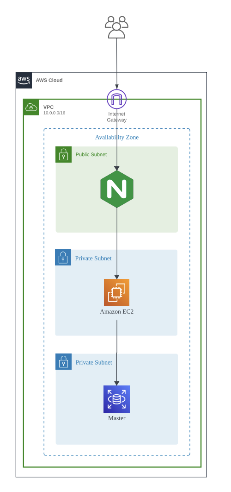
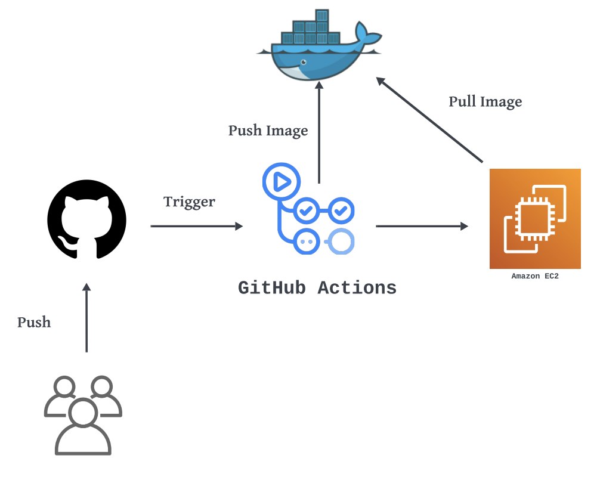
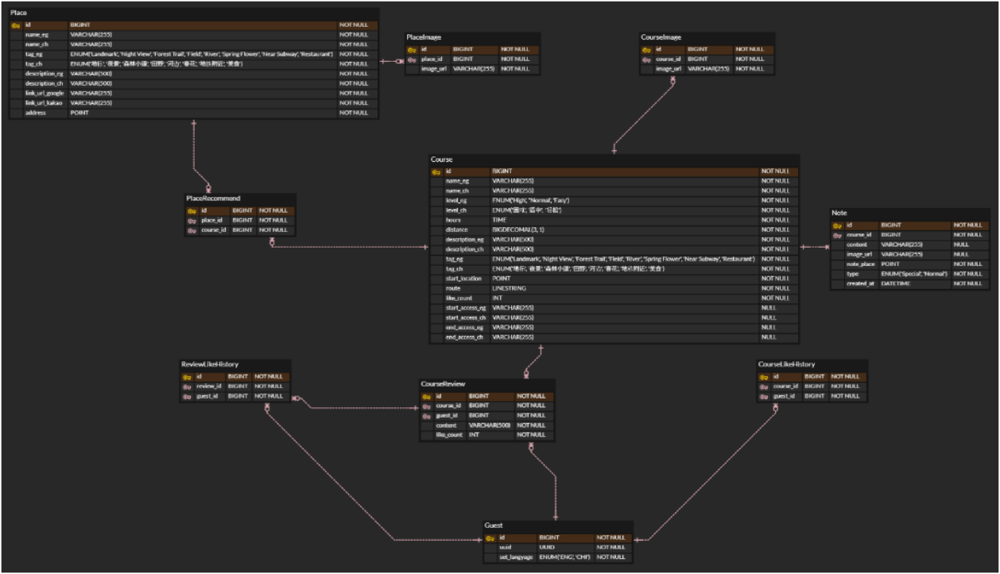

# 03. 아키텍처 & 인프라

---

## 1. 전체 구성 (3-Tier)

```
                          ┌─────────────────────────┐
   외국인 사용자   ───────▶│  Next.js / React        │
   (영어 · 중국어)          │  Vercel 배포            │
                          └───────────┬─────────────┘
                                      │ HTTPS / REST (JSON)
                                      ▼
                          ┌─────────────────────────┐
                          │  Nginx (Public Subnet)  │  리버스 프록시 · TLS 종단
                          └───────────┬─────────────┘
                                      ▼
                          ┌─────────────────────────┐
                          │  Spring Boot 3.5.5      │  6개 도메인 REST API
                          │  EC2 (Private Subnet)   │  Docker(linux/arm64)
                          └───┬──────────┬──────────┘
                              │          │
             ┌────────────────┘          └────────────────┐
             ▼                                            ▼
  ┌──────────────────────┐                    ┌───────────────────────┐
  │ MySQL 8.x (RDS)      │                    │ 외부 연동             │
  │ + Spatial Extension  │                    │ · Upstage Solar LLM   │
  │ POINT / LINESTRING   │                    │ · Google Maps         │
  │ SRID 4326            │                    │ · Kakao Map (딥링크)  │
  └──────────────────────┘                    │ · Amazon S3 (이미지)  │
                                              └───────────────────────┘
```

**계층 분리 원칙**
- 프론트엔드는 지도 렌더링·경로 그리기(Google Maps JS SDK)를 직접 담당하고, 서버는 **좌표와 데이터만 서빙**한다. 서버가 외부 지도 API를 대신 호출하지 않으므로 외부 API 장애가 백엔드 응답 지연으로 전이되지 않는다.
- 백엔드는 트랜잭션 정합성이 필요한 영역(좋아요 토글, 리뷰·쪽지 작성, 위치 검증)만 책임진다.

---

## 2. AWS 인프라 구성



| 계층 | 구성 |
| --- | --- |
| **VPC** | `10.0.0.0/16`, 단일 Availability Zone |
| **Public Subnet** | Internet Gateway → Nginx (리버스 프록시) |
| **Private Subnet #1** | Amazon EC2 — Spring Boot 애플리케이션 컨테이너 |
| **Private Subnet #2** | RDS(MySQL) Master — 애플리케이션에서만 접근 가능 |
| **스토리지** | Amazon S3 — 공공데이터 원천 이미지 링크의 휘발성 문제를 해결하기 위한 자산 아카이빙 |

**설계 의도**
- DB를 Private Subnet에 격리하여 외부 직접 접근을 차단
- 애플리케이션 컨테이너 역시 Private Subnet에 두고 Nginx를 통해서만 노출
- 예산 제약(AWS 프리티어·크레딧 한도) 때문에 Multi-AZ 대신 단일 AZ 구성을 선택 — 가용성보다 비용 효율을 우선한 의도적 트레이드오프

---

## 3. CI/CD 파이프라인



`dev` 브랜치 push 시 자동 배포되는 GitHub Actions 워크플로입니다.

```
Developer ──push──▶ GitHub ──trigger──▶ GitHub Actions
                                            │
                                            ├─ 1. JDK 25 (Temurin) 셋업
                                            ├─ 2. 설정 yaml 주입 (Secrets → base64 → tar 해제)
                                            ├─ 3. ./gradlew bootJar
                                            ├─ 4. QEMU + Buildx (linux/arm64 크로스빌드)
                                            ├─ 5. Docker Hub push
                                            └─ 6. EC2 SSH 접속 → pull & 재기동
```

**주요 결정 사항**

| 항목 | 결정 | 이유 |
| --- | --- | --- |
| 이미지 아키텍처 | `linux/arm64` | EC2 Graviton 인스턴스 사용 — 동일 예산 대비 성능/비용 효율 |
| 크로스 빌드 | QEMU + Buildx | x86 러너에서 arm64 이미지를 빌드하기 위함 |
| 설정 파일 주입 | Secrets에 base64 tar 번들 저장 후 빌드 시점에 해제 | 다중 프로파일 yaml을 저장소에 커밋하지 않으면서 한 번에 주입 |
| 배포 방식 | SSH → `docker pull` & 재기동 | 예산 제약상 ECS/EKS 대신 단일 EC2 운영 |

> 저장소에는 `application-example.yaml` 템플릿만 커밋하고, 실제 자격 증명이 담긴 yaml은 `.gitignore` 처리 후 CI Secrets로만 주입하는 정책을 적용했습니다.

---

## 4. 데이터 모델 (ERD)



### 테이블 구성

| 테이블 | 역할 | 핵심 컬럼 |
| --- | --- | --- |
| **Course** | 산책로 (핵심 엔티티) | `start_location POINT`, `route LINESTRING`, `level_eg/ch`, `tag_eg/ch`, `like_count` |
| **CourseImage** | 코스 이미지 (1:N) | `course_id`, `image_url` |
| **Place** | POI — 맛집/랜드마크 | `address POINT`, `tag_eg/ch`, `link_url_google`, `link_url_kakao` |
| **PlaceImage** | 장소 이미지 (1:N) | `place_id`, `image_url` |
| **PlaceRecommend** | Course ↔ Place N:M 매개 | `course_id`, `place_id` |
| **Note** | 위치 기반 쪽지 | `note_place POINT`, `type(Special/Normal)`, `created_at` |
| **CourseReview** | 코스 리뷰 | `course_id`, `guest_id`, `content`, `like_count` |
| **Guest** | 비인증 사용자 | `uuid BINARY(16)`, `set_language(ENG/CHI)` |
| **CourseLikeHistory** | 코스 좋아요 이력 | `course_id`, `guest_id` |
| **ReviewLikeHistory** | 리뷰 좋아요 이력 | `review_id`, `guest_id` |

### 스키마 설계에서 신경 쓴 지점

**① 다국어를 번역이 아닌 스키마로 해결**

런타임 번역 API를 호출하면 응답 지연과 비용, 그리고 고유명사 오역 문제가 발생합니다. 대신 언어별 컬럼을 이원화했습니다.

```
name_eg / name_ch                   이름
level_eg (Level) / level_ch (LevelCh)   난이도 — enum 인덱스 1:1 대응
tag_eg (Tag) / tag_ch (TagCh)           태그 — enum 인덱스 1:1 대응
description_eg / description_ch     설명
```

`Level`(`High/Normal/Easy`) ↔ `LevelCh`(`困难/适中/轻松`), `Tag`(8종) ↔ `TagCh`(8종)를 **인덱스 순서로 1:1 대응**시켜, 필터링은 항상 영문 enum(`tag_eg`) 기준으로 수행하고 응답 시점에만 언어를 선택합니다. 언어가 늘어도 조회 로직은 그대로입니다.

**② 좋아요 카운트 비정규화 + 이력 테이블 분리**

`Course.like_count`는 집계 캐시이고, 실제 누가 눌렀는지는 `CourseLikeHistory`에 남깁니다.
- 목록 조회(인기순 정렬)에서 매번 `COUNT(*)` 집계를 하지 않아도 됨
- 로그인이 없는 환경에서 `(course_id, guest_id)` 조합으로 중복 추천을 차단

**③ 공간 타입을 애플리케이션이 아닌 DB에 위임**

`POINT SRID 4326` / `LINESTRING SRID 4326`으로 저장하고 거리 연산은 `ST_Distance_Sphere`로 처리합니다. JTS의 `Point.distance()`는 평면 거리라 위경도에서 미터 단위로 동작하지 않기 때문에, 정확한 구면 거리가 필요한 위치 검증은 반드시 DB 함수를 사용하도록 통일했습니다.

---

## 5. 좌표계 처리 정책

| 구간 | 좌표계 / 순서 | 비고 |
| --- | --- | --- |
| 서울시 공공데이터 원본 | TM (EPSG:5181) | 평면 직각 좌표 |
| ETL 변환 후 적재 | WGS84 (EPSG:4326) | Proj4로 변환 |
| DB 저장 (JTS / MySQL) | `POINT(경도 위도)` = `(x, y)` | JTS·MySQL 표준 순서 |
| Google Maps API | `(lat, lng)` = `(위도, 경도)` | **순서가 반대** |

> 좌표 순서 역전은 실제로 초기 테스트에서 '좌표 꼬임' 버그의 원인이 되었습니다. 이후 변환 책임을 `CourseDistanceService` 한 곳에 모아, 호출자가 순서를 신경 쓰지 않도록 경계를 명확히 했습니다.

---

## 6. 백엔드 패키지 구조

```
com.globalstep.globalstepBe
├── domain
│   ├── course      Course, CourseImage, CourseLikeHistory
│   ├── place       Place, PlaceImage, PlaceRecommend
│   ├── note        Note (LBS 쪽지)
│   ├── review      CourseReview, ReviewLikeHistory
│   ├── guest       Guest (비인증 사용자)
│   └── map         지도 초기 설정 · 마커 (엔티티 없는 조회 전용 도메인)
│       └── 각 도메인: controller / dto / entity / repository / service
└── global
    ├── config      Swagger, CORS, GeometryFactory, @ConfigurationProperties
    ├── exception   ErrorCode, BusinessException, GlobalExceptionHandler
    ├── response    ApiResponse<T> (공통 응답 래퍼)
    └── external
        ├── google  GoogleMapsClient, WalkingInfo
        └── solar   SolarModerationClient, SolarCallGuard, RuleBasedProfanityFilter
```

**도메인형 패키지 구조를 택한 이유** — 4인 팀에서 도메인 단위로 작업을 나눌 때 계층형(`controller/`, `service/`가 최상위)보다 충돌이 적고, 도메인별 응집도가 높아 이후 기능 추가 시 영향 범위가 명확합니다.
