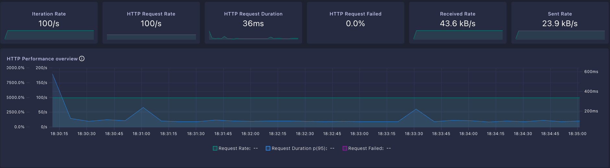

# 07. 성능 · 부하 테스트

> 부하 테스트 실행 및 지표 수집은 팀원이 담당했으며, 본 문서는 결과와 백엔드 관점의 해석을 정리한 것입니다.

---

## 1. 테스트 설계

k6로 5가지 부하 프로파일을 구성하고, `PROFILE` 환경변수로 전환할 수 있게 했습니다.

| 프로파일 | 시나리오 | 목적 |
| --- | --- | --- |
| `smoke` | 20초 / 2 VU | 스크립트·엔드포인트 정상 동작 확인 |
| `load` | 30초 ramp → **2분 20 VU 유지** → 30초 정리 | 평상시 예상 트래픽 (핵심 측정 구간) |
| `stress` | 50 → 100 → 200 → 300 VU 단계 증가 | 한계점 탐색 |
| `spike` | 10 → 300 VU 급증 후 급감 | 트래픽 폭증 대응 |
| `soak` | 30 VU로 30분 유지 | 메모리 누수·커넥션 누수 확인 |

### 임계값 (Thresholds)

```javascript
thresholds: {
    http_req_failed:   ['rate<0.01'],   // 실패율 1% 미만
    http_req_duration: ['p(95)<500'],   // 95%가 500ms 이내
    custom_error_rate: ['rate<0.01'],
}
```

### 시나리오 — 실제 사용자 동선 재현

단일 엔드포인트를 때리는 대신, 실 사용 흐름을 그룹으로 묶고 think time(1~3초 랜덤)을 넣어 현실적인 부하를 만들었습니다.

```javascript
group('장소(Place)', () => {
    GET /api/place?language=ENG                                   // 전체 장소
    GET /api/place?user_x=...&user_y=...&distance=3000            // 반경 조회 (공간 쿼리)
});
group('코스(Course)', () => {
    GET /api/courses?user_x=...&user_y=...&sort=popular           // 목록 + 정렬
});
group('지도(Map)', () => {
    GET /api/map/config
    GET /api/map/markers?center_x=...&center_y=...&distance=3000  // 반경 마커 (공간 쿼리)
});
sleep(Math.random() * 2 + 1);   // think time
```

기준 좌표는 서울시청 인근(`126.978, 37.5665`)을 사용했습니다.

> **의도적으로 공간 쿼리 비중을 높였습니다.** `/api/place?distance=`, `/api/map/markers`는 모두 `ST_Distance_Sphere` 연산이 들어가는 무거운 경로입니다. 단순 CRUD만 측정하면 이 서비스의 실제 병목을 못 봅니다.

---

## 2. 결과



### 최종보고서 기록 지표

| 항목 | 목표 | 결과 |
| --- | --- | --- |
| 총 요청 수 | — | **2,166건** |
| HTTP 성공률 | 99% 이상 | **100%** (에러 0건) |
| 평균 응답 시간 | 1초 미만 | **16.9ms** |
| 최대 응답 시간 | — | **218ms** |

### 대시보드 캡처 (별도 실행 구간)

| 지표 | 값 |
| --- | --- |
| Iteration Rate | 100/s |
| HTTP Request Rate | 100/s |
| HTTP Request Duration | 36ms |
| **HTTP Request Failed** | **0.0%** |
| Received / Sent Rate | 43.6 kB/s / 23.9 kB/s |

초기 스파이크(약 600ms) 이후 곧바로 안정 구간으로 수렴하며, 전체 측정 구간에서 실패율 0%를 유지했습니다. 초기 스파이크는 JVM 워밍업(JIT 컴파일)과 커넥션 풀·Hibernate 초기화에 따른 것으로, 이후 평탄한 그래프가 이를 뒷받침합니다.

---

## 3. 백엔드 관점의 해석

**왜 이 수치가 나왔는가** — 응답 속도에 기여한 설계 결정들입니다.

| 결정 | 효과 |
| --- | --- |
| **공간 연산을 DB에 위임** | `ST_Distance_Sphere` + 공간 인덱스로 반경 필터링·거리 정렬을 DB에서 처리. 전체 로우를 메모리로 올려 정렬하지 않음 |
| **외부 API 호출 제거** | 경로 계산을 프론트엔드로 이관해 조회 경로에 외부 네트워크 왕복이 없음. 서버 응답 시간이 외부 API 지연에 좌우되지 않음 |
| **`@EntityGraph` fetch join** | 코스 목록 조회 시 이미지 N+1 제거 — 목록 API가 쿼리 수에 비례해 느려지지 않음 |
| **`readOnly = true` 기본값** | 조회 위주 워크로드에서 flush·더티체킹 스냅샷 비용 제거 |
| **`open-in-view: false`** | 뷰 렌더링까지 DB 커넥션을 붙잡지 않음 → 동시 요청에서 커넥션 풀 고갈 방지 |
| **좋아요 카운트 비정규화** | 인기순 정렬에서 매번 `COUNT(*)` 집계를 하지 않음 |

---

## 4. 현장 GPS 대조 시험

부하 테스트와 별개로, 실제 산책로를 방문해 GPS 트래킹과 서비스 경로를 대조했습니다.

- 1차 테스트에서 **일부 좌표 꼬임** 발견 (좌표계 변환 및 순서 문제)
- MySQL 공간 인덱싱 적용 + Polyline 데이터 경량화로 보완
- 최종적으로 **오차 범위 10m 이내** 정합성을 전수 확인

---

## 5. 한계와 후속 과제

정직하게 남겨둔 부분입니다.

| 한계 | 설명 | 개선 방향 |
| --- | --- | --- |
| **읽기 경로 위주 측정** | 부하 시나리오가 GET 조회 중심 — 쓰기(리뷰·쪽지·좋아요 토글) 경합은 충분히 검증되지 않음 | 쓰기 시나리오 추가, 특히 동일 게스트 연타 시 좋아요 토글 race condition |
| **데이터 규모** | 코스·POI 각 100건대 — 공간 인덱스의 진짜 이점은 데이터가 늘어야 드러남 | 전국 단위 확장 후 재측정 |
| **마커 API 무제한 반환** | 반경 내 마커를 페이징·클러스터링 없이 전부 반환 | 데이터 증가 시 클러스터링 도입 필요 |
| **단일 AZ 구성** | 예산 제약으로 Multi-AZ 미적용 | 가용성 요구가 생기면 RDS Multi-AZ + ALB |
| **LLM 경로 미포함** | 부하 시나리오에 쓰기가 없어 Solar 모더레이션 구간은 측정 대상 밖 | `SolarCallGuard`의 동시성 제한(5) 자체가 상한이므로 별도 측정 필요 |

---

## 6. 실행 방법

```bash
# 평상시 부하 (기본)
k6 run -e BASE_URL=https://api.example.com load-test.js

# 프로파일 지정
k6 run -e PROFILE=stress -e BASE_URL=http://localhost:8080 load-test.js
```

`handleSummary`로 실행 결과를 `summary.json`에 저장해 회차별 비교가 가능하도록 구성했습니다.
